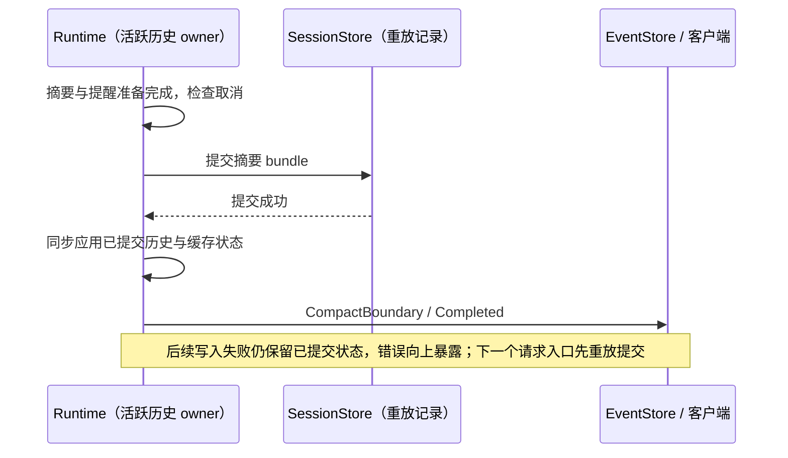

# ZCode CLI Compact 设计 v2

## 文档定位

原生递归分层、持久化分页取回与长期验收的实现合同见 [native-context.md](./native-context.md)。

路径回归验收使用平台原生绝对路径构造虚拟文件系统和 Read 状态；Windows 下不能把
POSIX 字符串路径与经 `resolve` / `join` 的运行时路径混用。文件补回、权限、取消、计划引用
和冷恢复断言必须实际执行，不能按操作系统跳过或放宽断言。

本文记录 ZCode v2 compact 的候选设计。当前文档属于 `L1 Candidate Contract`：它明确 compact 的领域边界、状态变化、对外契约和风险，但不固定最终 TypeScript 接口、数据库表结构或事件字段全集。

实施拆分见 [plan.md](./plan.md)。

compact 阶段语义与 memory read/write path 的增量改造计划见 [compact-phase-memory-plan.md](./compact-phase-memory-plan.md)。

Compact 的目标不是简单减少 UI 中可见消息，而是在不丢失当前任务连续性的前提下，把模型可见上下文从“完整历史”切换为“断点 + 总结 + 必要恢复上下文”。因此它必须和 session、message chain、tool result、memory、hooks、rewind、file checkpoint、resume 和 trace 一起设计。

---

## 一、内部怎么做

### 1.1 核心概念

ZCode v2 应把 compact 视为 session 状态机中的一类结构化事件，而不是一个直接改数组的工具函数。

核心对象：

- `CompactBoundary`：上下文断点，表示边界之前的历史已经被 summary 覆盖。
- `CompactSummary`：模型可见的压缩摘要，承接边界之前的用户意图、文件变化、错误修复和当前任务状态。
- `PostCompactContext`：compact 后继续发给模型的活跃上下文。
- `PreservedSegment`：在部分 compact 或 session-memory compact 中保留的原始消息区间。
- `CompactMetadata`：记录触发方式、压缩前 token、被总结消息数量、保留区间、summary 来源和 trace 信息。

标准 post-compact 顺序是：

```text
compact boundary
compact summary
messages to keep
attachments
hook results
```

ZCode 保留这种顺序语义：先声明边界，再给 summary，再接原始保留消息和恢复上下文。这样 session replay、resume、UI projection 和 provider request 都能用同一个断点模型理解 compact。

### 1.2 触发路径

Compact 至少需要三类触发路径。

自动 compact：每轮模型请求前根据活跃上下文 token 估算判断。策略是给 summary 输出和后续请求预留 buffer，不等到真正满窗才 compact。ZCode 应把阈值策略做成配置化 policy，例如 `effectiveContextWindow - reservedOutputTokens - compactBufferTokens`，并记录阈值来源。

手动 compact：用户通过命令主动压缩当前上下文。手动 compact 可以附带 summary 指令，但不能绕过权限、hook、trace 和持久化流程。

局部 compact：用户在 rewind/message selector 等 UI 中选择“从这里开始总结”或“总结到这里”。这不是普通 rewind，而是把一段历史替换成 summary，同时保留另一段原始消息。

触发前必须有递归保护。compact 自身调用模型生成 summary 时，不能再次触发 compact；session memory、summary agent、subagent 等 forked query 也应根据 `querySource` 或执行上下文避免互相压缩。

#### 1.2.1 本地 token 估算合同

Provider usage 是上下文占用的权威来源；没有 usage anchor 或计算 anchor 后新增消息时，
本地字符估算统一复用 `ESTIMATED_TOKEN_CHAR_DIVISOR = 3` 并向上取整。

消息估算覆盖文本 content、reasoning，以及每个 assistant tool call 的
`name + JSON.stringify(input ?? {})`。tool call id 不计入；tool result 已由消息 content 计入。
无法 JSON 序列化的异常 tool input 仅在本地估算中按 `{}` 计算，避免预算辅助路径中断
compact 或 preflight；该降级不改变 tool 执行和持久化合同。

### 1.2.2 选择性区间压缩（ranges，P2 执行与持久化 + P3 读侧/生命周期已落）

手动 compact 支持显式选择若干消息区间，只折叠这些区间，区间之外的消息保持原样：

```json
{ "ranges": [ { "startMessageId": "msg_a", "endMessageId": "msg_b" } ] }
```

- 输入：`CompactNowInputSchema.ranges`，1–16 段，`{startMessageId,endMessageId}` 均为持久化
  消息 id（`message.info.id`），strict；不传时沿用原前缀折叠。`CompactNow` handler 原样转发，
  port / pending / turn-loop / `compactActiveConversation` options 全链路透传。
- 语义（已实现）：每段独立生成摘要并原位替换；端点自动外扩到 assistant round 边界
  （tool_use/tool_result 不可拆），扩后重叠的段合并；外扩若吞掉用户显式保留的 gap 则整单拒绝
  并在错误里回报实际生效区间；不生成 preservedSegment/leading 公告，但日期、计划模式、工具
  目录等操作级提醒重发一次；整单原子——先做全量预校验（id 存在、在活跃分支、token>0、外扩后
  不重叠、每段 prompt 不超限、旧摘要具有持久化身份和边界、不含 assistant error、不折上下文前缀），
  全过才开始摘要，任一段失败则不落盘、不替换活跃链；每段一次模型调用（并发 2，共享
  abortSignal；`modelCall.logicalCallId = "<operationId>:range_N"`）。
- 执行落点：`compactActiveConversation` 检测到 ranges 后调用
  `compactActiveConversationWithRanges`；`planCompactRanges` 负责选择与校验，
  `buildPostCompactRuntimeEntriesForRanges` 负责 live 链原位替换；每段发一条
  `ModelComplete`，`boundary.truePostCompactTokenCount` 在全部替换完成后回填；文件补回、
  plan 文件引用、PostCompact hook 与 legacy 对齐（补回范围取最后一个区间之后的保留段）。
- 持久化：每段一条 compaction part + 一条 summary 消息 + 一个 `CompactBoundary` 事件，共享
  同一 operationId；per-range 覆盖声明放 `part.metadata.compactRange = { rangeId,
  startMessageId, endMessageId, summaryMessageId }`（宽松字段，不改 strict boundary），并写
  `compactFormat: "ranges-v1"`；`persistCompactSummaries` 把所有记录一次
  `commitMessageBundle` 提交，操作级提醒只追加一次。
- 冷恢复（P1 已实现）：`compact-session.ts` 的 `compactSessionMessages` 收集所有活跃 boundary，
  按 boundary 消息的物理顺序（即写入顺序）逐条重放——range 记录先移除摘要消息的物理出现，
  再把 `[startMessageId..endMessageId]` 连续段原位替换为摘要；legacy 记录仍按「保留声明 +
  前缀裁剪」语义处理；完全不含 ranges 记录的历史 session 直接走旧函数，结果逐字节等价。
  任一条定位失败（端点缺失、区间重叠/嵌套、声明摘要 id 与 boundary 消息不一致）抛出
  SessionCorrupted，并保留结构化原因；不再警告后返回未裁切历史。resume/rewind 的消息锚点
  从已恢复的活跃时间线读取，不再对该时间线重复重放压缩记录。
- 读侧（P3 已实现）：`CompactedRange` 带上 `rangeId/startMessageId/endMessageId`；
  `foldedWindowForRange` 对 ranges-v1 记录按显式端点定位（summary 追加在物理末尾，不能再按
  「相邻 boundary 的 messageIndex」推导）；`collectFoldedMessageIndexes` 只把显式区间内的原文
  标 folded，gap / 未选前缀 / 更早摘要仍算活跃；混合会话里若最新一条是 legacy，仍沿用旧前缀
  判定。`SearchContext` / `DecompressContext` / `CompactStatus` 三个消费方自动跟随。
- fork / rewind / sqlite（P3 已实现）：`runtime/helpers/steering.ts` fork 时重映射
  `metadata.compactRange` 的三个 id；`sqlite-session-store` 的 `assertForkBundleChildLocal`
  校验它们必须 child-local；`evaluateRewindTarget` 的 coveredByCompact 改为「target 落在某个
  显式区间内」——gap / 未选前缀是活跃消息，不再被误判成已被压缩（最新记录是 legacy 时仍用旧规则）。
- PreCompact hook（P3 已实现）：ranges 路径先跑 PreCompact，`additionalContext` 合并进每段
  摘要请求；`block` 时整单 skipped、不落盘；钩子返回 `compactionSummary` 时仅单区间可直用，
  多区间会拒绝并返回 `pre_compact_summary_requires_single_range`（一份宿主摘要无法拆成 N 段）。
- 去重键（P2 修复）：`transcript-hydration` 对同一 operationId 下 ≥2 个边界身份的 range part
  用 `operationId + boundary 身份` 复合键，operation 级 `CompactCompleted` 取最后一段的
  boundary/summary/tailStart；`cold-event-merge` 始终保留 operation 级键作 fallback，并为
  range 操作补逐段键；legacy 单 part 的键与选择规则逐字节不变。
- 契约：`CompactRangeMetadata` 与 `CompactionPartMetadata.compactRange / compactFormat` 已加入
  `@zcode/contracts`（宽松字段，旧版本按 JSON 读取时忽略）。
- 投影：`lastCompact` 仍表示最后一个折叠点；`CompactStatus` 按 boundary 数组展示全部段，
  将来再加 `compactRanges?: []` additive 字段。
- 兼容：旧版本读取含 ranges 的会话时只会认最后一个 boundary，把之前的历史全部当作已折叠——
  模型上下文会静默塌缩为「最后一段摘要 + 尾部」，但 SQLite 原文不丢，已接受并在发版说明标注。
- 工具说明：`ranges` 的 schema describe 与 `CompactNow` 的 modelInstructions 已面向模型描述
  选择性压缩用法（原 P0「未启用/会被拒绝」文案已移除）。
- 当前状态：P0 契约、P1 冷恢复重写内核、P2 执行/持久化/去重键、P3 读侧显式 range /
  fork remap + sqlite 校验 / rewind 判定 / PreCompact hook 均已落。剩余：e2e ranges 用例、
  发版说明（旧版本静默塌缩的最低版本要求）；`lastCompact` 仍只表示最后一个折叠点（已拍板接受）。

### 1.3 执行流程

一次 full compact 的内部流程应是：

1. 从当前 session projection 中取最近 compact boundary 之后的 active messages。
2. 执行轻量压缩或预算裁剪，例如 tool result budget、microcompact、snip。
3. 判断是否满足 compact policy；手动 compact 直接进入执行。
4. 运行 `PreCompact` hook，允许追加受控 summary 指令或阻止 compact。
5. 构造 summary prompt。summary agent 只能输出文本，不允许工具调用。
6. 调 provider 生成 summary，并把 prompt-too-long、网络中断、无文本输出等失败归一化。
7. 创建 `CompactBoundary` 和 `CompactSummary`。
8. 生成 post-compact 恢复上下文，例如最近文件、plan 状态、已加载 skill、agent 状态、MCP/tool 声明、session start hook 结果。
9. 写入 session event store，并刷新 UI projection。
10. 运行 `PostCompact` hook，记录 telemetry，清理已失效的缓存。

业务 core 只表达这些状态转移和意图。模型请求、文件读取、session 存储、hook 子进程、网络和日志都必须通过 adapter 完成。

### 1.4 Summary 内容要求

Compact summary 应稳定覆盖这些信息：

- 用户的显式请求和约束。
- 已做过的关键决策、方案取舍和当前假设。
- 涉及的文件、代码位置、接口和数据结构。
- 已发生的错误、失败原因、修复方式和用户反馈。
- 当前任务进行到哪里，下一步应该接什么。
- 仍未完成的待办和不应再重复尝试的路径。
- 对后续 agent 有用的环境、权限、模式和工具状态。

Summary prompt 可以要求模型先写内部分析块，但进入 post-compact context 的内容必须是清洗后的 summary。ZCode 不应把 summary agent 的草稿推回主上下文。

### 1.5 Microcompact 和 full compact 的边界

Microcompact 只处理局部上下文压力，不应等同于 full compact。

可选策略：

- provider-neutral local microcompact：对旧 tool result 做 provider-visible 内容清理，只保留占位符、原始大小、tool id 和可追踪 artifact/session 引用；不修改原始 transcript、tool part 或 workspace checkpoint。
- time-based local microcompact：长时间 idle 后如果 provider cache 预计过期，可主动清理旧 tool result，减少下一次请求重写成本。
- pressure-based local microcompact：当活跃上下文超过 microcompact 阈值但还没到 full compact 阈值时，先清理旧 tool result，避免过早生成有损 summary。
- provider-specific cached microcompact：只有 provider adapter 明确声明支持时，才使用 cache edit/reference 删除服务端缓存中的旧 tool result；它是可选优化，不是 ZCode 的主路径。

Microcompact 不应创建 full `CompactBoundary`，除非它真的改变了可恢复消息链。它需要自己的事件类型或 metadata，避免 resume/rewind 把它误解成历史断代。

Local microcompact 是请求前的 active-context projection。它可以替换当前内存中的
provider-visible tool result 内容，但不能删除 session store 里的原始 tool part；
resume 后可以再次按同一 policy 投影。成功时应写 `microcompact_boundary` 等价事件，
记录 trigger、strategy、pre/post token estimate、cleared tool call ids、kept tool
call ids 和 traceId。该事件只服务观测和 UI，不参与 full compact active-chain 截断。

### 1.6 Session memory compact

如果 ZCode 引入 session memory，应把它作为 compact 的一种 summary 来源，而不是绕过 compact 机制。

流程上可以先尝试 session memory compact：

- 等待正在进行的 memory extraction 完成。
- 校验 session memory 文件不是空模板。
- 根据 `lastSummarizedMessageId` 计算已被 memory 覆盖的消息。
- 保留最近消息，避免只剩 summary 而丢失现场。
- 如果压缩后仍超过阈值，回退到传统 summary compact。

这条路径仍然要产出相同的 `CompactBoundary`、`CompactSummary` 和 post-compact projection。

### 1.7 持久化和恢复

Compact 必须进入 append-only session log。不能只改内存数组，否则 resume、continue、SDK 和后台任务会看到不同历史。

自动和模型溢出触发的压缩：配置关闭、未达阈值、无可压缩内容及插件明确阻止属于正常跳过；
执行过程中抛出的异常（包含摘要模型、hook 和存储错误）保留原始原因，终止当前轮并通过既有
TurnError 暴露。未提交时不得替换活跃历史，也不得继续向模型发送本轮正常请求。连续失败达到
熔断阈值且当前仍需要压缩时，停止自动重试并报告明确错误；手动或自动压缩成功后重置熔断。
切换到更大上下文使当前用量低于阈值时，无需压缩的轮次可正常继续。

持久化要求：

- `CompactBoundary` 是 message chain 的逻辑断点。
- boundary 之前的消息在 active chain 中应被 summary 覆盖。
- 如果 compact 后保留了一段原始消息，必须记录 `PreservedSegment`，用于 replay 时把保留段重新接到 summary 或 boundary 后面。
- compact 前的 session metadata、title、tag、mode、worktree state 等不能因为裁剪历史而丢失。
- replay 时应优先构建 post-compact chain；只有 relink 元数据损坏时，才进入保守兜底。

relink 失败时选择不 prune，避免因为边界元数据损坏导致历史不可恢复。采用这个保守原则时必须打结构化告警，并把异常归入同一个 `traceId`。

#### 提交、取消与后续事件失败（2026-11-02 回归修复）

前缀与 ranges 路径共用以下提交语义：Runtime 是活跃历史的唯一所有者，摘要 bundle
是重放的权威记录。摘要、文件补回和提醒准备完成后，在提交前最后检查取消；取消时
不写摘要、不替换历史。提交一旦成功，必须在下一次 await 之前同步更新 messageHistory、
latestConversationMessageId、文件读取状态、memory recall 与 nudge 基线；提交期间到达的
取消不能把已经落盘的状态退回旧历史。



提交后的事件/完成时间线/PostCompact 故障不得重新摘要、不得将已提交操作改记为 failed 或
interrupted；记录 `compact.post_commit.failed` 后向上暴露原错误。提交落盘后直到后续事件、
完成时间线和 PostCompact 钩子全部完成，Runtime 一直保留这份提交的重放输入；同步应用本身
或后续任一步失败时，自动压缩也必须向上暴露错误并终止当前轮，保留重放输入。普通轮、后台
通知、子代理消息及 control-only 入口都必须在写入新的活跃历史前重放，否则重放会覆盖新消息。
重放再次失败按 `InvalidStateTransition` fail-closed，不向模型发送旧历史；后台队列中尚未写入
的消息保留待重试，失败通过回合错误事件向客户端暴露。`resumeFromStore` 与 rewind
以存储/重建结果为唯一事实，会清空重放输入。未写完的 started/retrying 时间线由既有 resume
恢复入口根据 operationId 对应的持久化 boundary 收敛为 completed。PostCompact 观察的是已提交
的活跃历史，返回的 additionalContext 在替换之后追加。
停止收尾期间追加的已提交条目（interrupt marker、目标暂停/状态提醒）通过同一历史写入入口
追加到同一份待重放输入；
下一轮重放只替换折叠前历史，不能覆盖提交后的新条目。冷恢复与 rewind 计算对话和 assistant
锚点时排除 provider-hidden 时间线，区间压缩后立即恢复也必须保留尾部正文的锚点。
回归覆盖：前缀/ranges 的提交前取消、提交期间取消、bundle 写失败、boundary 事件失败、
完成时间线写失败、完成事件失败、自动压缩提交后错误终止当前轮、跨轮重放、后台消息不丢失、
持续失败 fail-closed，以及失败后继续执行/冷恢复一致性与禁止重复摘要。

#### 恢复终态、模型来源守卫与拒绝反馈（2026-11-03 修复）

- 恢复保留原因：started/retrying 时间线收敛为 interrupted 或 completed 时，原 compaction part 的
  `reason` 必须原样写入恢复后的内存 part 与持久化记录。`reason` 可能承载失败原因（如 `api_error`），
  也可能承载 `summary_origin:*` 来源前缀；恢复不能只保留来源前缀而丢失失败原因。
- 模型来源守卫终态：`modelCompact` 请求的 ranges 必须包含非空区间与摘要。形状不合法时守卫直接拒绝：
  不调用摘要模型、不改活跃历史、不写 boundary，并写一条 `Skipped` 终态压缩时间线，
  `reason = model_source_invalid_ranges_or_summaries`，供 UI 与诊断使用；不得静默返回 skipped。
- 参数校验指南范围：CompactNow 输入校验失败时，只有错误路径命中 `ranges`/`summary` 契约才追加
  「需要精确 startMessageId」的区间指南；`instructions`、`reason` 等无关字段错误只返回原始校验错误，
  避免把模型引向无关修复。
- 拒绝反馈的时效标注：CompactNow 拒绝（如 unknown message id）后若同一轮发生自动压缩，拒绝事实必须保留，
  但反馈要注明自动压缩已改变历史、拒绝针对折叠前索引，重试前必须使用刷新后的上下文索引与持久化 message id。
  该反馈只进入当前轮请求，不写入 messageHistory。
- 回归覆盖：retrying→interrupted 与已提交→completed 均保留 reason；模型守卫写 Skipped 终态；
  无关参数错误不追加区间指南；折叠后拒绝反馈带陈旧提示且不持久化。

### 1.8 清理和缓存失效

Compact 后这些状态通常需要清理或重建：

- read file cache 和文件内容状态。
- nested memory / instruction cache。
- system prompt section cache。
- microcompact 的 tool id 状态。
- permission classifier 的短期缓存。
- provider prompt cache break detector 的 baseline。
- context collapse 或其他上下文投影状态。
- session message cache。

清理逻辑要区分主线程和 subagent。subagent compact 不应清掉主线程共享的模块级状态。

---

## 二、对外要求和可能的副作用

### 2.1 对用户的行为承诺

ZCode 对外应把 compact 描述为：

```text
清理旧对话历史，但保留一份可继续工作的上下文总结。
```

用户需要能理解三件事：

- compact 后模型主要依赖 summary，而不是逐字旧历史。
- compact 后 UI 可以继续展示历史，但展示历史不等于模型仍能看到历史。
- compact 后 rewind、resume 和 file checkpoint 的可用范围可能变化。

手动 compact 应允许用户提供额外总结要求，例如“重点保留测试输出、文件路径、失败原因”。这些要求应进入 `PreCompact` 指令合并流程，并记录到 compact metadata 中。

### 2.2 对 SDK / TUI / CLI 的事件要求

Compact 必须对外发出结构化事件，而不是只输出一段文本。Core 是 compact 生命周期的事实来源，不能提前把 TUI/ZCode app-server 文案写进事件；它只发布 `status`、`trigger`、`phase`、`compactReason`、`display`、token 统计、boundary/summary id 和失败原因等机器可读字段。

至少需要：

- `compact.started`
- `compact.progress`
- `compact.boundary.created`
- `compact.summary.created`
- `compact.completed`
- `compact.failed`

事件应包含 trigger、sessionId、turnId、traceId、pre/post token 估算、summary 来源、是否保留原始消息区间、失败原因和是否可重试。

SDK 消费者需要能识别 compact boundary。TUI 消费者需要能在视觉上标记“这里发生了压缩”。CLI 非交互模式需要把 compact 结果写入 transcript，并返回可机器解析的状态。

Compact timeline 的显示规则属于客户端投影：

- TUI 根据 `status + trigger + display` 从自身 copy registry 渲染分隔线文本和状态行。
- ZCode app-server transport 根据同一结构生成 timeline metadata，供客户端识别 synthetic timeline；若外部兼容协议要求纯文本 fallback，该文本只能在 transport/client 层生成，不能来自 core payload。
- Session store 可以保留旧版本写入的 `timelineText` 用于兼容历史数据，但新写入的 compact timeline part 不再持久化渲染文案。
- Replay 时优先使用结构化字段恢复 timeline；旧历史缺少结构化字段时，才允许读取 legacy `timelineText` 作为兜底。

### 2.3 对配置和权限的要求

ZCode 自有配置和环境变量必须使用 `ZCODE_` 前缀。

建议配置项：

- `autoCompactEnabled`：是否启用自动 compact。
- `compact.maxSummaryOutputTokens`：summary 输出预算。
- `compact.bufferTokens`：自动 compact 触发 buffer。
- `compact.maxConsecutiveFailures`：自动 compact 失败熔断次数。
- `compact.preserveRecentTokens`：session memory compact 或 partial compact 的最近上下文保留量。

调试和运维 override 不声明环境变量入口，优先使用 config file、CLI/session override 或测试注入。新增 `ZCODE_` 环境变量必须先补齐 spec，明确用途、优先级、错误行为和测试覆盖。

权限上，compact 自身通常不是危险操作，但它会触发 provider 请求、hook 执行、session 写入和可能的文件读取恢复附件。因此它的副作用范围至少包括 `network`、`workspace`、`session-storage` 和 `user-visible-state`。

### 2.4 对 rewind 的影响

Compact 对 rewind 有直接影响。

Conversation rewind 依赖可选择的 user message 和当前 active message chain。Full compact 后，compact 前的 user message 通常不再在 active chain 中；即使 UI 仍保留 scrollback，模型上下文和 message selector 也应以最近 boundary 后的投影为准。

File rewind 依赖 user message UUID 对应的 file history snapshot。如果 snapshot 的锚点消息已经被 compact prune，resume 后可能无法从 active chain 中恢复这个 checkpoint。ZCode 需要明确策略：

- compact 前的 file checkpoint 是否继续出现在 UI 中。
- 如果显示，是否只能恢复文件，不能恢复对话。
- 如果不显示，是否提供“历史 checkpoint 已被 compact 覆盖”的解释。
- partial compact 是否要把 checkpoint metadata 迁移到 boundary 或 summary 上。

默认建议：compact 后只承诺 rewind 到 compact boundary 之后的消息。compact 前的 checkpoint 可以作为高级恢复能力保留，但必须标注风险，不能假装是完整 conversation rewind。

### 2.5 对 resume / continue 的影响

Resume 应恢复 compact 后的 active chain，而不是完整旧历史。否则 compact 会在当前进程有效、重启后失效，导致 token 爆炸和行为不一致。

因此：

- session replay 必须识别最后一个 `CompactBoundary`。
- boundary 前历史默认不进入 active provider context。
- summary 和 preserved segment 必须足够恢复当前任务。
- 如果 preserved segment relink 失败，可以保守加载完整历史，但必须记录告警并尽快触发二次 compact 或提示用户。

### 2.6 对模型行为的副作用

Compact 的主要收益是降低 token 压力，但副作用是信息损失和语义漂移。

可能问题：

- summary 遗漏用户限制，后续 agent 违背旧约束。
- summary 把未完成任务写成已完成。
- 文件路径、代码片段、错误原因被概括过度。
- 旧 tool result 被 microcompact 清空后，模型无法复查原始输出。
- summary 引入不存在的事实，导致后续实现跑偏。
- compact 后 prompt cache 失效，下一轮请求成本和延迟上升。

缓解要求：

- summary prompt 必须强调用户显式要求、文件路径、错误修复和当前工作。
- compact 结果要保留 transcript 路径或 artifact 引用，让 agent 能主动查旧历史。
- 关键 tool result 应进入 artifact/storage，而不是只靠 summary。
- compact 后第一轮应可观测，包括 token、cache、summary size、是否马上再次触发 compact。

### 2.7 对 hooks、memory、skills 和 tools 的副作用

Compact 会刷新一部分上下文状态，因此会影响周边功能。

Hooks：`PreCompact` 可以修改 summary 指令或阻止 compact，`PostCompact` 可以做通知和审计。hook 失败不应破坏 session log，一定要有结构化错误和用户可见提示。

Memory：compact 会让旧消息离开 active chain。memory extraction 需要知道哪些消息已经被 summary 覆盖，否则会重复总结或漏总结。

Skills：已调用 skill 的关键内容需要在 compact 后重新注入，或者用更轻的 invoked-skill attachment 保留。不能每次 compact 都无界重发所有 skill 内容。

Tools：deferred tool schema、MCP instructions、agent listing 等不能只依赖旧历史；compact 后必须由
model request tools 或明确的 delta attachment 重新声明，否则模型会丢工具上下文。

### 2.8 对观测和测试的要求

Compact 必须具备可诊断性。

观测至少覆盖：

- 触发来源：auto、manual、partial、reactive、session-memory。
- compact 前后 token 估算。
- summary 输入 token、输出 token、cache read/create token。
- 被总结消息数量、保留消息数量、附件恢复数量。
- 是否连续 compact 或 compact 后立刻再次超过阈值。
- 失败原因、重试次数、是否触发熔断。
- compact boundary 与 replay/relink 的一致性。

测试至少覆盖：

- 自动阈值触发和关闭配置。
- 手动 compact 自定义指令。
- compact 期间 summary 请求 prompt-too-long 的重试。
- session memory 可用和不可用的回退。
- partial compact 两个方向的消息顺序。
- compact 后 rewind 只看到合法范围。
- compact 后 resume 不加载被裁剪历史。
- preserved segment relink 成功和失败兜底。
- subagent compact 不清理主线程共享状态。

### 2.9 设计原则

Compact 是有损操作，但不应是不可观测操作。

ZCode v2 的基本原则：

- 有损边界必须显式进入 session log。
- 任何跨进程、跨恢复、跨 SDK 的 compact 结果都必须有 runtime schema。
- UI 展示历史和 provider active context 必须分层，不允许混淆。
- Rewind 能力必须基于 active chain 和 checkpoint metadata 明确声明范围。
- Compact 失败默认向上冒泡到有能力处理的层；只有可恢复、可重试或可降级时才捕获。
- 所有 compact 子任务都必须继承同一个 `traceId`。
