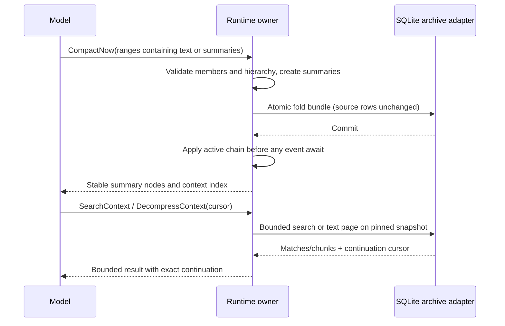
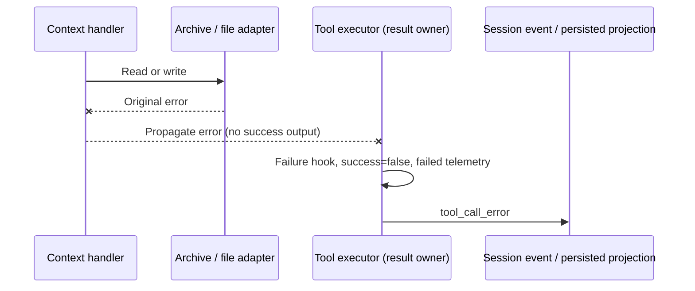
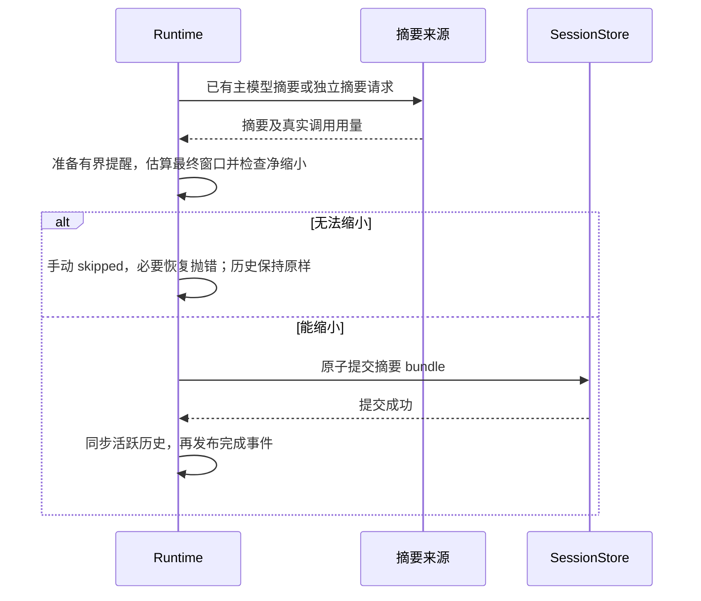

# Native context archive and recursive folds

目标：由 ZCode Runtime 原生完成模型主动压缩、递归摘要层级、完整原文分页取回、可观测长期运行；
SQLite 保存不可删除的原文与折叠节点，模型不依赖 bili 代理、MCP 或独立守护进程。

## 状态与提交

- Runtime 是活跃上下文唯一 owner；沿用 CompactNow 单槽 admission 和现有提交/取消修复。
- 每个摘要是有稳定 messageId 的 fold 节点，记录直接成员 messageIds、子 boundaryIds、level 和
  原文叶节点数量。第一层 level=1；包含摘要时 level=max(child.level)+1。子节点原文与摘要均不删除。
- ranges 可以选择旧摘要及其相邻原文，先外扩到完整工具轮；显式保留的 gap 不得被吞掉。
  摘要节点本身是独立轮边界，不能与前一条 user 合组，否则第二次压缩会额外吞掉稳定前缀。
  冷恢复以直接成员 id 在当前逻辑链重放，允许声明的子摘要，不接受未声明的重叠/损坏节点。
- fork 重映射直接成员和摘要 id；rewind/search/decompress/status 使用同一当前分支与层级事实。
- 前缀兜底按摘要 token 预算保留稳定的旧摘要，不按固定四层裁剪；需要合并时记录子节点关系。
- 摘要重试可以缩短模型输入，但持久化成员取最终实际折叠选区并排除原样保留的摘要，
  不能因请求截短而漏掉已从活跃上下文移除的原文。

## Archive port 与分页

- 错误可见性（2026-11-02）：archive/文件写入异常保留原始错误并向上抛出，由工具执行器
  唯一收口为 `success:false`、`tool_call_error`、failure hook 与失败计量。端口显式返回
  `status:failed` 时也转为工具失败；`not_found`、正常空页与带游标的中间页仍是成功调用。
  toFile 非法路径和缺失文件端口分别报 InvalidInput / ConfigurationError，不伪装成成功结果。
- 冷恢复无法重放压缩区间或 DAG 时抛 SessionCorrupted（上下文包含 relink 原因和边界数），
  不返回未裁切历史、不改写持久原文；错误沿现有恢复入口暴露，阻止发送失真的 provider 上下文。
  resume / rewind 先选定活跃时间线，随后查找 latest message 的纯函数只遍历该结果，
  不得再次重放压缩：已被替换的原文端点不在活跃链中，重复重放会错误地判为损坏。
- 摘要模型只有目录明确判定不存在、禁用或推理档位不可用时才允许警告后回退；目录实现和
  模型工厂抛出的异常原样上抛，不把内部程序错误当成可选配置问题。未配置时仍直接使用默认模型。

- contracts 提供 ContextArchivePort；SQLite adapter 执行数据库查询，core 只负责工具语义与结果。
  search/read/status 都不调用会话全量 `messages()`；三个读取工具必须配置 ContextArchivePort，
  缺少端口时明确报配置错误，不再保留全量 transcript 的第二条执行路径。
- search 匹配完整持久化 text/output/error，返回有界 snippet；folded、role、scope 与分支过滤不变。
  仅有 summary.body 的摘要由同一 SQLite 端口读取，不恢复另一套存储回退；检索同时支持
  完整短语、空白分词和连续中文的相邻双字词片，snippet 使用相同匹配规则。
- DecompressContext 增加 cursor；结果增加 nextCursor。原文可以按多页完整取回，不能再每条固定
  截断 20,000 字符后没有继续入口。toFile 写当前页并回传 nextCursor；不伪报导出完整。
- 原文档位沿子摘要递归展开到叶消息；summary 档位只取所选层。分页顺序稳定、无重无漏。
  messageIds 正文与 ranges/boundaryId 使用同一选择；没有关联折叠的普通消息不附带其他边界。
  多节点选择只在关联边界唯一时返回 boundaryId，详情通过 CompactStatus 查看。
  先定位页内 part 再转换正文，每页最多转换 32 个 part，不逐页转换整个所选历史。
  ranges 是预算内的相关边界索引，完整列表由 CompactStatus 分页读取。仅包含不可读 part 的
  中间页可以返回 0 条正文和 nextCursor，调用方应继续直到游标缺省。
- cursor 绑定 session、选择参数、分支与快照上界；正常 append 不使游标失效，换选择或 rewind
  拒绝旧游标。输入严格校验，数据库参数绑定。字符/UTF-8 字节均受结果预算限制。
- status 返回分页节点及缓存/摘要调用计量，保留旧字段兼容。大历史只加载有界正文，避免 JS
  构造整条会话内容；取消在读取分页边界响应。

## DeepSeek V4.1 Flash 成本优化（2026-11-02）

- Runtime 继续唯一持有活跃历史，摘要来源不产生第二套提交或恢复链路。
- 独立摘要请求使用完整活跃历史的工具发现事实，但只投影待摘要内容；当前作用域已禁用的工具
  不得被历史发现记录重新启用。system、tools 和引用投影与主请求保持一致，摘要指令只追加尾部。
- CompactNow 的每个 range 可携带 `summary`（非空，最多 24,000 字符）。一批必须全部提供或全部
  省略；提供时端点必须是完整轮的精确边界，不能合并或扩大摘要覆盖范围。乱序按实际位置关联。
  主模型正文在安全点直接进入现有 ranges 提交路径，不新增摘要模型请求、不伪造 ModelComplete
  或额外模型费用。PreCompact 仍可阻止；新附加指令需要重新生成摘要时明确拒绝本次提交。
- 模型提交的摘要只有在最终上下文（含提醒）比折前更小时才提交，否则 skipped，原文和前缀
  保持不变。正文作为历史数据，不升级为 system 指令；取消、原子提交、重放和冷恢复沿用现行合同。
- 独立摘要不要求输出随后丢弃的 analysis 正文；保留目标、约束、决定、精确标识和未完成工作。
  DeepSeek 的推理预算与摘要正文预算不可混为一个 2K 的硬上限。
- DecompressContext 默认内联预算降为 10,000 字符，显式 maxChars 和 toFile 仍可扩大；分页游标
  必须逐字节读完原文。模型应先搜索，再读片段，不在一次取回中重新填满上下文。
- 折后体积属于本地估算；摘要调用费用来自实际 usage，主模型提交正文的费用已计入主请求，
  不重复记账。真实服务商缓存收益必须独立实测，不由请求哈希或模拟用量宣称达成。

### 续修合同（2026-11-03）

- 新生成的 boundary、完成时间线及 compact 返回值统一以折后活跃上下文的本地估算作为
  `postCompactTokenCount` / `tokenCount`；`truePostCompactTokenCount` 保持相同值。摘要请求
  实际 input/cache/output 仍由 ModelComplete、model_usage 和持久化 cacheUsage 承载，不得
  把 input+output 当作折后窗口大小，不得把本地体积差标成真实费用收益。
  估算截面是摘要 bundle 提交时的活跃历史；PostCompact 钩子随后新注入的内容属于后续变化，
  最终模型请求体积由 provider usage 记录。旧记录若缺少 truePost 估算，状态显示未知，不能
  将旧 post 字段里的摘要调用总量当作窗口大小。
- DeepSeek V4.1 Flash（`deepseek-v4.1-flash` 及官方别名 `deepseek-flash`）的独立摘要和
  钩子摘要与模型直写一样，在所有提醒生成后检查净缩小。手动/主动请求不缩小时 skipped，
  不落摘要、不改历史；阈值触发或 reactive 超窗恢复确实需要释放空间时，无法缩小应抛出
  不可重试的 ModelContextExceeded，停止本轮，不能循环重读历史或继续假称压缩成功。
- Flash 的自动文件补回限最近 2 个、单文件 4,000、本次共 6,000 估算 tokens，仍排除保留
  视图已有的 Read 正文、指令文件和计划文件，遵守当前读权限、取消与真实磁盘内容。其他
  模型沿用既有预算，不增加用户配置或环境变量。未补回文件由 Read/Decompress 按需读取。
- Runtime 仍是唯一状态所有者；旧原文保留在 archive，真实摘要调用即使未提交也正常计费。
- Flash 的主动压缩提醒提供最多 3 个有净收益潜力的完整轮区间（单轮估算至少 4,000 tokens），
  保留首轮和最近两轮，优先列更靠后的已完成大块。候选与执行器共用轮边界，摘要或工具配对
  不得被切开；只是建议，不自动扩大选区、不强制模型照做，也不预测会话剩余轮数。
  提醒优先要求主模型批量提交 ranges[].summary，避免继续引导其走昂贵的独立摘要。
- CompactNow 的 accepted 只代表准入；安全点执行后若 skipped，下一次模型请求用
  `compact_result` 当轮附件返回拒绝原因和实际端点，模型能据此修正。附件在自动压缩之后
  才加入请求，下一个步骤清除，不能进入 canonical history 或被摘要持久化。
- `compact_nudge`、`compact_result`、`context_index` 在 provider 投影中也必须留在逻辑尾部，
  不得冒泡到旧用户输入之前，也不得并入旧工具结果；MCS 开关与工具结果合并能力均不改变
  此约束。两次请求之间删除/重建这些附件后，已有稳定消息的正文与顺序应保持相同。
- pre/post 窗口估算采用继续会话模型的 MCS 投影；摘要请求和摘要 prompt 预算仍采用摘要
  模型自身的投影。PreCompact 直接提供正文时没有摘要 ModelRequest/ModelComplete。
- 摘要的取回说明、工具公告、nudge 和 context_index 只依据本轮有效工具集合；CompactNow 被隐藏则不催调，
  SearchContext/DecompressContext 不在集合中则不在摘要中承诺可调用，不以全局 registry 猜测。
  三种工具均不可用时不生成 context_index；只开放部分工具时索引只说明这些工具的用途。

## 验收与交付

2026-11-03 Flash 专项优化与 Terra 复审已覆盖：模型直写摘要、当前工具发现与权限、摘要
端点和批次校验、独立摘要及钩子摘要的净缩小检查、文件补回预算、窗口与调用用量分离、
临时提示的前缀稳定性、冷恢复及完整原文分页。UI 以严格 display 契约显示原生上下文工具；
排队与真正完成分别呈现，CompactStatus 整页最多 200 个节点及逐节点用量不再被展示层截掉。

可重复入口是 `pnpm --dir apps/zcode-cli test:native-context`。专题入口直接解析 contracts
源码，避免旧 dist 使 schema 回归出现假结果；不要求先构建安装。源码类型检查以 noEmit 运行。
架构检查仅验证登记范围内的边界；CLI lint 保留已有上游行数错误的原始级别与接纳原因。
本轮最终专题回归为 31 个文件、856 项通过；原生工具浏览器组件覆盖中英文、明暗主题与
390/1200 宽度共 8 组通过。core/contracts/adapters 源码与 UI/shared 的 noEmit 检查通过。

现有 OpenCode Go / `deepseek-v4.1-flash` 接入的少量纯合成验收（2026-11-03）：

- 固定输入与工具的对照：摘要后缀请求命中 98.88%；删除一个可见工具时 0%，恢复后回到
  98.88%。这证明此服务上的工具前缀差异可导致缓存失效，不代表每次全 miss 都由工具引起。
- 源码 Runtime + 真实 SQLite 的 5 代折叠完成 17 次请求、0 次独立摘要调用，原文逐字节
  还原、一次冷恢复与 5/5 精确 anchor 和全局约束召回通过。
- 大输入（9,000 条合成记录）在前缀修复后，压缩请求 input 271,111 / cached 270,464，
  命中 99.76%；tools hash 不变，前缀公共字符 916,511。修复前公共前缀仅 1,754 字符。
  该次共 5 次请求、0 次独立摘要调用，原文分页还原、冷恢复和最终召回通过。
- 另一次模型提前主动压缩，使早期验收脚本误把摘要 id 当作原文 id；该次记为验收失败。
  脚本改为精确匹配原文，明确分阶段操作后重跑通过，失败证据仍保留，未归类成 provider 成功。

以上通过有界非流式接入运行、关闭 thinking，并使用隔离 SQLite 与合成文本；不是桌面端到端
或生产 streaming 验收，也不是长期会话与实际账单的因果成本实验。折叠后首请求仍可能只有
约 70% 命中；不能承诺始终 90% 以上。主模型直写仍要求 ranges，手动/阈值/超窗的独立摘要
作为明确路径保留。四份历史研究报告保持原样，后续金额结论应读取真实 provider usage。

- 先修复已有八个路径用例，保持跨平台权限、取消、文件补回、计划与恢复断言。
- 多代折叠与原文逐字节重建、summary 分层取回、搜索尾部、重启/fork/rewind、提交故障均有回归。
- 长程验收记录活跃 token 上限、压缩次数/层级、完整召回、前缀稳定性、provider usage 和压缩开销。
  确定性 provider 的协议/缓存模拟结果与真实模型质量/缓存计量必须明确区分。
- 使用受管模块登记契约、core context 和 adapter 扩展；不放宽架构策略或刷新基线掩盖问题。
- 撤销本功能新增的 compact-active / cold-event-merge 行数告警豁免；清理重复投影逻辑使其符合
  800 行限制。既有上游行数基线仍独立登记，但 CLI lint 必须逐条输出原始级别、文件与原因，
  不只打印“接纳 N 项”；其它错误继续阻断。CLI lint 支持 Windows 独立 pnpm.exe 的标准入口。
- 一次确定性模型和真实 SQLite 的长程验证完成 48 代折叠、6 次重启与 48/48 精确召回；
  47 次稳定前缀检查通过。测试模型记录摘要请求 input 24,000、cache read 19,200、output 768
  tokens；这些数字只验证计量链路，不能证明真实 provider 的缓存命中、费用收益或摘要质量。
- 摘要成员映射、中文检索、原文分页、插件提示词注入预算、压缩提交及异常恢复由对应回归测试
  持续覆盖；运行时状态以源码和当前测试为准，不以旧审查报告或旧内核哈希代表当前版本。
- 发布新内核需独立构建并核对实际产物；`--noEmit` 类型检查不会更新已安装版本。
